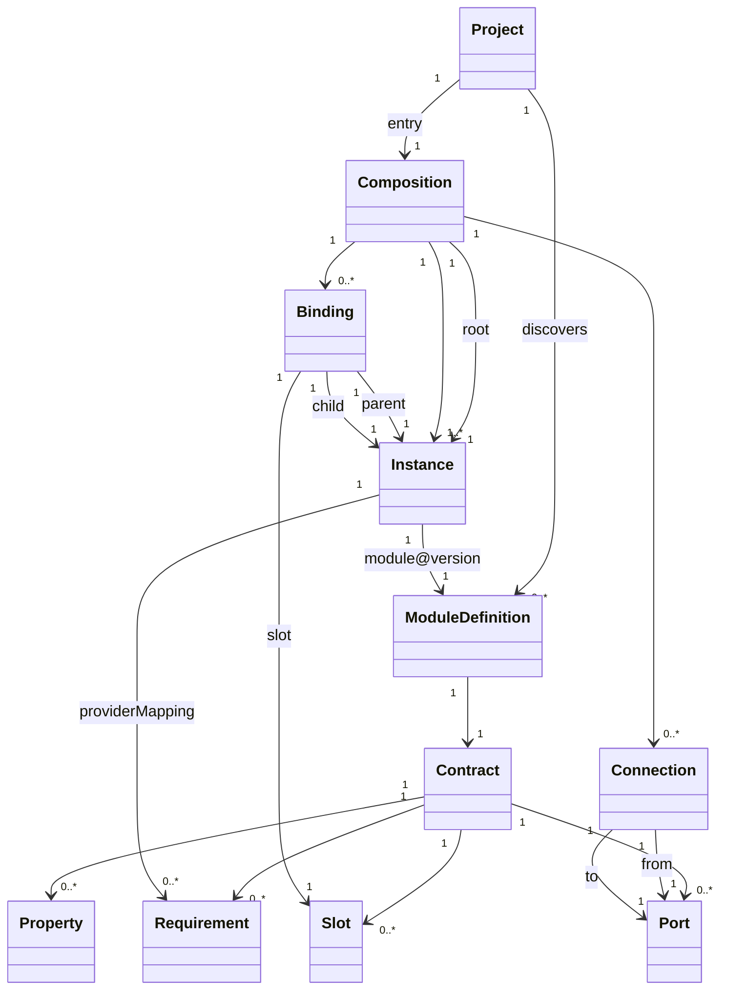

# Composition Domain Model v1

- 状态：M0 冻结（2026-11-26）
- 适用范围：Composition Designer v0.1
- 关联：[`composition-schema-v1.md`](./composition-schema-v1.md)、[`error-codes-v1.md`](./error-codes-v1.md)、[`../glossary.md`](../glossary.md)

本文件定义 v0.1 的领域对象、关系语义与不变量。它不依赖 TOML 语法；TOML 字段名、默认值与
错误代码在 `composition-schema-v1.md` 中映射。任何实现（Core / CLI / Designer / Agent Adapter）
都必须满足这里的语义，不得各自发明规则。

## 1. 权威模型

- 每个项目工作区只有一个 **Composition Model**，由项目声明（TOML）唯一决定。
- 可视化 Canvas、TOML Source、Agent Interface、CLI 都是同一模型的入口；它们不得各自维护
  一套互不一致的项目结构。
- 规范化模型（Normalized Model）是 Core 的输出：确定性、可序列化、带来源位置。

## 2. 对象总览

`Diagnostic` 与 `Revision` 是 Core 的结果对象，不出现在项目声明图中。

## 3. 对象定义

### 3.1 Project

项目工作区的根与入口。

| 字段（语义） | 说明 |
|---|---|
| `project_id` | 稳定项目标识；不依赖目录名 |
| `name` | 面向用户的显示名 |
| `schema_version` | 声明格式版本；v0.1 固定为 `1` |
| `root_path` | 项目根目录（绝对路径，仅供 Core/UI 定位） |
| `composition_entry` | 唯一 Composition 入口文件（相对 root） |
| `module_roots` | 模块定义搜索目录列表（相对 root，非空） |

不变量：

- **PRJ-1**：项目根目录中存在且只存在一个 `project.toml` 作为入口；不识别嵌套项目。
- **PRJ-2**：`project_id` 在项目生命周期内稳定，符合模块 ID 词法，不由目录名推断。
- **PRJ-3**：`schema_version` 为整数 `1`；其他值在 v0.1 显式拒绝。
- **PRJ-4**：`composition_entry` 与每个 `module_root` 都位于项目根内，必须是相对路径且不得越界。
- **PRJ-5**：`module_roots` 非空、无重复、无互相包含的隐式合并语义。

### 3.2 Module Definition

可复用模块的定义与契约。v0.1 中模块定义只读：Designer 不得在项目内编辑模块定义。

| 字段（语义） | 说明 |
|---|---|
| `module_id` | 稳定模块标识（点分小写） |
| `version` | 精确版本 `MAJOR.MINOR.PATCH` |
| `kind` | `composite` 或 `primitive` |
| `contract` | 属性、Slot、Port、依赖要求 |
| `source_path` | 定义文件位置 |

不变量：

- **MOD-1**：`(module_id, version)` 在所有已发现定义中唯一；重复定义是错误。
- **MOD-2**：`kind` 只允许 `composite` / `primitive`；`primitive` 不得声明 Slot。
- **MOD-3**：同一模块内属性 ID、Slot ID、Port ID、依赖 ID 分别唯一。
- **MOD-4**：属性契约自洽：类型受支持、约束适用于该类型、默认值符合类型与约束。
- **MOD-5**：`required = true` 的属性不得同时声明默认值（有默认值就不再是必填）。
- **MOD-6**：Slot 的 `required` 与 `cardinality` 必须一致（见 §5.3）；`accepts` 非空。
- **MOD-7**：依赖要求的目标是模块 ID；版本若声明则必须是精确版本。
- **MOD-8**：模块定义是只读输入；运行时与编辑事务不得隐式改写它。

### 3.3 Instance

模块定义在项目中的一次实例化。

| 字段（语义） | 说明 |
|---|---|
| `instance_id` | Composition 内唯一实例 ID |
| `module_ref` | `(module_id, version)`，版本精确匹配 |
| `config` | 本实例显式配置（只含模块声明的属性） |
| `effective_config` | 应用默认值后的有效配置（不写回源文件） |
| `dependency_providers` | 可选：依赖 ID → 提供者实例 ID |
| `source` | 声明位置 |

不变量：

- **INS-1**：`instance_id` 在 Composition 内唯一。
- **INS-2**：`module_ref` 必须唯一解析到一个模块定义，且版本精确相等；不得“取最新”或“就近匹配”。
- **INS-3**：`config` 只能包含模块声明的属性；类型与约束必须满足；必填属性缺失即错误，
  除非该属性有默认值（此时进入 `effective_config`）。
- **INS-4**：`dependency_providers` 的键必须是模块声明的依赖 ID；提供者必须是存在的实例、
  满足目标模块与版本、且不是自己。
- **INS-5**：实例形态继承模块的 `kind`；Root 实例必须是 `composite`。

### 3.4 Binding

结构组合关系：父实例的某个 Slot 接纳子实例。

| 字段（语义） | 说明 |
|---|---|
| `binding_id` | Composition 内唯一 |
| `parent` | 父实例 |
| `slot` | 父模块声明的 Slot ID |
| `child` | 子实例 |

不变量：

- **BND-1**：`binding_id` 唯一；`(parent, slot, child)` 三元组唯一。
- **BND-2**：`parent` / `child` 必须存在；`child` 不得是 Root。
- **BND-3**：`parent` 的模块必须是 `composite`，且声明了 `slot`；`child` 的模块必须在该 Slot
  的 `accepts` 列表中。
- **BND-4**：每个非 Root 实例必须且只能有一个父级 Binding（单父规则）。
- **BND-5**：Root 不得有父级 Binding。
- **BND-6**：Binding 图必须无环；一个实例不能成为自己的祖先。
- **BND-7**：所有实例都必须从 Root 可达；不存在孤立实例。
- **BND-8**：每个 Slot 的绑定数量满足其 `cardinality` 与 `required`（见 §5.3）。

### 3.5 Slot

Composite 模块接纳子实例的结构单元。

| 字段（语义） | 说明 |
|---|---|
| `slot_id` | 模块内唯一 |
| `cardinality` | `one` / `optional_one` / `many` |
| `required` | 是否至少需要一个绑定 |
| `accepts` | 允许的模块 ID 列表（非空） |

Slot 只存在于 `composite` 模块。`accepts` 只按模块 ID 判断，不按版本；实例版本仍须自己能解析。

### 3.6 Dependency

依赖要求与解析结果，不等于结构包含。

| 字段（语义） | 说明 |
|---|---|
| `requirement_id` | 模块内唯一 |
| `target_module` | 目标模块 ID |
| `target_version` | 可选，精确版本 |
| `optional` | 缺失提供者是否允许（warning） |
| `provider` | 解析出的提供者实例（结果字段） |

不变量：

- **DEP-1**：依赖要求由模块定义声明；实例通过 `dependency_providers` 显式指定提供者。
- **DEP-2**：未显式指定时，只在“恰好一个匹配实例（排除自己）”时自动解析成功；
  零个为未解析，多个为歧义，均返回诊断；不得自动挑选。
- **DEP-3**：依赖图允许成环；v0.1 不执行模块，环不构成结构错误，也不改变 Binding 树。
- **DEP-4**：依赖解析与 Binding 树完全独立：A 依赖 B 不代表 B 是 A 的子节点。
- **DEP-5**：`optional = true` 的缺失提供者是 warning；已声明提供者但无效仍是 error。

### 3.7 Port 与 Connection

Port 是模块对外暴露的输入/输出边界；Connection 是 Port 之间的显式连接。

| 对象 | 字段（语义） |
|---|---|
| Port | `port_id`、`direction`（`input`/`output`）、`type_id`、`multi`、可选 `protocol` |
| Connection | `connection_id`、`from`（实例 + 输出 Port）、`to`（实例 + 输入 Port） |

不变量：

- **CON-1**：Connection ID 唯一；两端实例与 Port 必须存在。
- **CON-2**：`from` 必须是输出 Port，`to` 必须是输入 Port。
- **CON-3**：两端 `type_id` 必须相等；两者都声明 `protocol` 时必须相等。
- **CON-4**：同一对端点不得重复连接（即使 ID 不同）。
- **CON-5**：`multi = false` 的输出 Port 最多一条出边，输入 Port 最多一条入边；
  `multi = true` 不限制。
- **CON-6**：Connection 不表示结构包含，也不表示依赖；不得据此推断父子或提供者。

### 3.8 Diagnostic

解析或验证发现的问题。

| 字段（语义） | 说明 |
|---|---|
| `code` | 稳定错误代码（见错误代码表） |
| `severity` | `error` / `warning` / `info` |
| `message` | 面向人的说明；不得作为机器判断依据 |
| `object_id` | 关联对象标识（如 `instance:app`），可空 |
| `file` | 相对项目根的源文件路径，可空 |
| `range` | 源码范围（行列，可空） |
| `related` | 关联对象 ID 列表，可空 |
| `hint` | 可执行的修正方向；不得暗中修改 |

不变量：

- **DIA-1**：`code` 稳定且来自 [`error-codes-v1.md`](./error-codes-v1.md)，不使用自然语言分类。
- **DIA-2**：能定位时给出 `file` + `range`；引用错误同时给出相关对象。
- **DIA-3**：诊断顺序确定（见 §7.3）；相同输入产生相同诊断序列。
- **DIA-4**：不级联刷屏：上游文件解析失败导致的下游检查跳过，只报告首要错误。

### 3.9 Revision

一次已提交的模型版本。

| 字段（语义） | 说明 |
|---|---|
| `seq` | 单调递增提交序号；初始读取为 `0` |
| `source_digest` | 语义声明文件集合的内容摘要 |

不变量：

- **REV-1**：每次成功提交 `seq` 加一；失败事务不产生新 Revision。
- **REV-2**：`source_digest` 由声明文件路径与字节内容计算，不依赖文件修改时间、进程或平台。
- **REV-3**：写操作必须携带读取时的 Revision；不一致时拒绝覆盖并要求重新读取。
- **REV-4**：Revision 变化只来自项目语义文件；`.designer/**` 不参与。

### 3.10 Presentation State

`.designer/**` 保存 Canvas 坐标、视口、面板状态与编辑器偏好。

- **PRE-1**：`.designer/**` 不属于 Composition Model，不参与解析、验证、Revision 与 digest。
- **PRE-2**：移动节点、缩放画布、展开面板只能改变 `.designer/**`，不得改变任何声明文件。
- **PRE-3**：`.designer/**` 未知字段对 Core 与语义无影响；由 Designer 负责容错与保留。

## 4. Binding / Dependency / Connection 对照

| 问题 | Binding | Dependency | Connection |
|---|---|---|---|
| 回答什么 | 谁在结构上包含谁 | 谁需要哪个模块 | 哪个输出连到哪个输入 |
| 方向 | parent Slot → child | 需求方实例 → 提供者实例 | 输出 Port → 输入 Port |
| 是否改变树 | 是 | 否 | 否 |
| 是否要求单父 | 是 | 否 | 否 |
| 是否允许成环 | 否 | 是（v0.1 不执行，不构成结构错误） | 允许自连/回连，仅受 `multi` 限制 |
| 典型反例 | “A 依赖 B，所以 B 是 A 的子节点” | “B 是 A 的子节点，所以 B 自动成为 A 的依赖提供者” | “A 与 B 有连接，所以 B 必须在 A 的 Slot 里” |

补充反例：

1. `app` 的 `content` Slot 绑定了 `editor`，但 `editor` 没有声明任何 Port，仍然合法；
   Binding 不产生数据连接。
2. `editor` 依赖 `state`，提供者可以是项目里任意位置的 `state-1` 实例，不需要被 `editor` 包含。
3. 两个实例之间有 Connection，仍可能各自有独立父级；Connection 不改变父级。

## 5. 组合与契约语义

### 5.1 Composition Root

- 必须存在唯一 Root；Root 是实例 ID，指向一个可解析的 `composite` 实例。
- Root 不得是任何 Binding 的 `child`。
- 所有其他实例必须能从 Root 经 Binding 到达。

### 5.2 树结构

- 非 Root 实例恰好一个父 Binding。
- Binding 图是一棵有向树，不允许环。
- 相同 `(parent, slot, child)` 重复声明是错误；同一 child 接到两个不同 Slot 也是错误。

### 5.3 Slot 基数

| cardinality | required | 绑定数 | 说明 |
|---|---:|---|---|
| `one` | true | 恰好 1 | 必填单值 |
| `optional_one` | false | 0 或 1 | 可选单值 |
| `many` | false | 0..N | 可选多值 |
| `many` | true | 1..N | 必填至少一个 |

其他 `required` 与 `cardinality` 组合在契约层即为错误（MOD-6）。

### 5.4 配置与默认值

- `config` 是用户显式值；`effective_config` 是 `config` 叠加属性默认值后的结果。
- 默认值只在解析时应用，**不得**因解析或验证写回源文件。
- Raw config 中的未知属性是错误，不静默丢弃。
- v0.1 属性类型为 `string`、`integer`、`float`、`boolean`、`enum`、`array`（元素为前五类之一）；
  `object` 属性显式不支持。
- TOML 的 `integer` 与 `float` 严格区分：`integer` 属性不接受浮点、`float` 属性不接受整数。

### 5.5 依赖解析

对每个实例的每条依赖要求：

1. 若 `dependency_providers` 显式给出 provider：校验实例存在、模块目标与版本匹配、不是自己；
   失败即 error。
2. 否则在项目全部实例中查找模块 ID 与（可选）精确版本匹配、且不是自己的实例：
   - 恰好 1 个：解析成功；
   - 0 个：`optional=true` 为 warning，否则 error；
   - 多个：error（歧义），要求显式指定 provider。

解析结果记录在规范性结果中，顺序稳定。依赖解析不使用 Binding 关系。

### 5.6 Connection 校验

- 先校验端点存在，再校验方向、类型、协议。
- 重复端点对与 `multi=false` 的度数限制在端点有效后检查。
- 任一端口无效时跳过该条 Connection 的方向/类型检查，避免级联。

## 6. 规范化模型

规范结果是机器可读数据，至少包含：

- `project`：`id`、`name`、`schema_version`；
- `composition`：`id`、`root`、`schema_version`；
- `modules`：每个定义及其契约、来源；
- `instances`：`id`、`module`（id/version）、`kind`、`config`、`effective_config`、来源；
- `bindings`：`id`、`parent`、`slot`、`child`、来源；
- `connections`：`id`、`from`、`to`、来源；
- `dependencies`：需求、实例、提供者、解析状态、来源；
- `diagnostics`：按 §7.3 排序；
- `revision`：`seq`、`source_digest`（无法计算时为 `null`）。

确定性要求：

- 无顺序语义的集合按稳定键排序（见 schema 文档 §8.2）；
- 相同输入、相同版本 Core → 字节级相同的规范化 JSON；
- 不使用哈希表迭代顺序、文件系统枚举顺序或当前时间。

## 7. 诊断语义

### 7.1 严重级别

| severity | 含义 | v0.1 使用 |
|---|---|---|
| `error` | 项目声明无效，不能提交 | 解析、Schema、引用、契约、结构、连接、依赖 |
| `warning` | 可用但需要处理 | 可选依赖缺失 |
| `info` | 提示 | v0.1 暂不产生 |

### 7.2 对象标识

| 对象 | `object_id` 形式 |
|---|---|
| Project | `project` |
| Composition | `composition` |
| Module Definition | `module:<id>@<version>` |
| Instance | `instance:<id>` |
| Binding | `binding:<id>` |
| Connection | `connection:<id>` |
| Property | `property:<module>@<version>#<property-id>` |
| Slot | `slot:<module>@<version>#<slot-id>` |
| Port | `port:<module>@<version>#<port-id>` |
| Dependency | `dependency:<module>@<version>#<dependency-id>` |
| File | `file:<relative-path>` |

### 7.3 排序

诊断按以下键升序：`file`（空值排前）、`range.start.line`、`range.start.column`、
`code`、`object_id`。相同键保持检查产生的稳定顺序。

## 8. 不变量索引

| ID | 不变量 | 层 | 错误代码（首个） |
|---|---|---|---|
| PRJ-1 | 唯一 `project.toml` 入口 | L1 | `file-project-missing` |
| PRJ-2 | 项目 ID 稳定且合法 | L2 | `schema-invalid-identifier` |
| PRJ-3 | `schema_version = 1` | L2 | `schema-unsupported-version` |
| PRJ-4 | 路径相对且不越界 | L1 | `file-path-escape` |
| PRJ-5 | `module_roots` 非空且唯一 | L2 | `schema-empty-value` / `schema-duplicate-entry` |
| MOD-1 | 模块 ID+版本唯一 | L3 | `id-duplicate-module` |
| MOD-2 | kind 合法，primitive 无 Slot | L4 | `contract-module-invalid` |
| MOD-3 | 契约 ID 分组唯一 | L3 | `id-duplicate-slot` 等 |
| MOD-4 | 属性契约自洽 | L2 | `schema-invalid-value` |
| MOD-5 | required 与 default 不共存 | L2 | `schema-inconsistency` |
| MOD-6 | Slot required/cardinality 一致 | L2 | `schema-inconsistency` |
| MOD-7 | 依赖目标合法 | L2 | `schema-invalid-identifier` |
| MOD-8 | 模块定义只读 | — | （M2 事务约束） |
| INS-1 | 实例 ID 唯一 | L3 | `id-duplicate-instance` |
| INS-2 | 模块精确解析 | L3 | `ref-module-not-found` / `ref-module-version-not-found` |
| INS-3 | 配置符合契约 | L4 | `contract-property-*` |
| INS-4 | provider 映射有效 | L6 | `dependency-provider-invalid` |
| INS-5 | Root 为 composite | L5 | `structure-root-not-composite` |
| BND-1 | Binding ID 与三元组唯一 | L3 / L5 | `id-duplicate-binding` / `structure-duplicate-binding` |
| BND-2 | 端点存在，child 非 Root | L3 / L5 | `ref-instance-not-found` / `structure-root-has-parent` |
| BND-3 | Slot 存在且接受子模块 | L4 | `ref-slot-not-found` / `contract-slot-rejects-module` |
| BND-4 | 非 Root 单父 | L5 | `structure-instance-multiple-parents` |
| BND-5 | Root 无父 | L5 | `structure-root-has-parent` |
| BND-6 | 无环 | L5 | `structure-cycle` |
| BND-7 | 全部可达 | L5 | `structure-unreachable-instance` |
| BND-8 | Slot 基数满足 | L5 | `structure-slot-cardinality` |
| CON-1 | 端点存在 | L3 | `ref-instance-not-found` / `ref-port-not-found` |
| CON-2 | 方向正确 | L6 | `connection-direction-invalid` |
| CON-3 | 类型/协议一致 | L6 | `connection-type-mismatch` / `connection-protocol-mismatch` |
| CON-4 | 端点对唯一 | L6 | `connection-duplicate` |
| CON-5 | multi 度数限制 | L6 | `connection-port-multi-violation` |
| CON-6 | 不推断父子/依赖 | — | （语义约束） |
| DEP-1 | 依赖来自模块声明 | L4 | `contract-dependency-unknown` |
| DEP-2 | 显式或唯一解析 | L6 | `dependency-unresolved` / `dependency-ambiguous` |
| DEP-3 | 依赖环不是结构错误 | — | （不产生诊断） |
| DEP-4 | 与 Binding 独立 | — | （语义约束） |
| DEP-5 | 可选缺失仅 warning | L6 | `dependency-optional-unresolved` |
| DIA-1 | 稳定错误代码 | 全部 | — |
| DIA-2 | 可定位 | 全部 | — |
| DIA-3 | 确定顺序 | 全部 | — |
| DIA-4 | 不级联 | 全部 | — |
| REV-1 | seq 单调 | M2 | `edit-revision-conflict`（M2） |
| REV-2 | digest 基于内容 | M1 | — |
| REV-3 | base_revision 冲突保护 | M2 | `edit-revision-conflict`（M2） |
| REV-4 | `.designer` 不参与 | M1 | — |
| PRE-1 | 表现层不进模型 | M1 | — |
| PRE-2 | 移动节点不改语义 | M3 | — |
| PRE-3 | 未知表现字段无影响 | M3 | — |

## 9. 与设计基线的差异

| 差异 | 设计基线 | v0.1 冻结 | 理由 / 记录 |
|---|---|---|---|
| 模块文件版本字段 | 示例无 `schema_version` | `module.toml` 也要求 `schema_version` | 三种声明文件独立演进；见 ADR-0001 |
| 依赖提供者 | 只说“要求用户显式指定” | 实例级 `dependency_providers` 映射 | 让“显式”可表达、可验证 |
| 依赖环 | 未说明 | 允许；不构成结构错误 | v0.1 不执行模块，环无运行时语义 |
| 多个 Root | 列为结构错误 | 单一 `root` 字段，重复键即 TOML 错误 | 模型上不可表达多个 Root |
| 属性 `object` | 列在类型建议中 | v0.1 显式不支持 | 避免过早引入嵌套 Schema；见 ADR-0002 |
| Connection | “首版可简单校验或推迟” | 支持简单方向/类型/协议与 multi 校验 | 满足 L6 与端口验收；不做协商与自动转换 |
| Revision digest | 内容摘要 + 提交序列 | `source_digest` 基于声明文件字节 | 精确、可复现，覆盖格式变化 |
| `.designer` | 语义文件之外 | Core 不读取；Designer 独占 | 保证 A15 与表现层隔离 |

详细决策与备选方案见 [`docs/adr/0001-domain-and-schema-freeze.md`](../adr/0001-domain-and-schema-freeze.md)
与 [`docs/adr/0002-v01-unsupported.md`](../adr/0002-v01-unsupported.md)。
